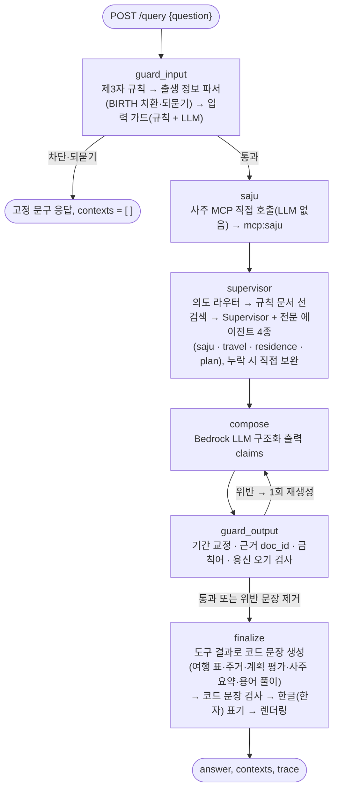

# 미니 PJT: 사주 라이프 플래너 (Saju Life Planner)

## 무엇을 푸나
사주 운세·여행·주거 정보가 흩어져 있어, 연말연시에 **내 운의 흐름에 맞춘 1년 여행·이사 계획**을 근거 있게 세울 수 없는 20~40대 직장인의 문제를 푼다. 출생 정보가 담긴 질문 하나로 12개 절기 월의 세운·월운을 계산하고, 월별 여행지·주거 지역 Top 3·이사 시기·내 계획의 적합도를 **근거(doc_id)와 함께** 답한다. 상세 기획은 [SERVICE.md](SERVICE.md).

## 활용한 패턴 (Day 1~7)
| # | 패턴 | 활용 |
|---|---|---|
| 1 | LCEL + Pydantic 구조화 출력 (Day 1) | 최종 답변을 `StructuredAnswer{claims[{section, text, doc_ids}]}`로 생성 → 섹션별 렌더링 ([src/schemas.py](src/schemas.py)). 답변 구성: 한눈에 보기(일상어 결론) → 사주 요약(원국·용신과 의미·세운·12개월 흐름) → 질문별 섹션 → 용어 풀이(답변에 나온 명리 용어, 규칙 문서 근거) → 근거 자료. 간지·오행은 `무술(戊戌)월`처럼 한글(한자)로 표기 |
| 2 | ReAct (Day 3) | 전문 에이전트 4종을 `create_react_agent`로 구성, 도구 자율 선택 |
| 3 | RAG: 하이브리드 검색 + 쿼리 확장 (Day 2) | kiwi 형태소 BM25 + Chroma(Titan v2), EnsembleRetriever 0.2/0.8(가중치 비교로 결정) RRF c=60, 용신 오행 키워드 결정론 확장 ([src/retriever.py](src/retriever.py)) |
| 4 | 도구 다중 (Day 4) | 사주 계산·여행/주거 추천·계획 평가·문서 검색 도구를 한 질의에 조합 |
| 5 | MCP 서버 연동 (Day 4) | ① mcp-saju **포크**(Node, 기준일 `now`·`get_luck_calendar` 추가) ② 장소 DB FastMCP 서버. 세션을 열어 두고 재사용 |
| 6 | 가드레일 (Day 5) | 제3자 규칙 → 출생 정보 파서 → 규칙 1차 → LLM 2차 판별, 고정 거절 문구, 부분 거절, 출력 금칙어 검사 ([src/guards.py](src/guards.py)) |
| 8 | 미들웨어: PII 마스킹·출력 검증·재시도 (Day 5) | 생년월일 `<BIRTH>` 치환(LLM 미전송), trace 2중 마스킹, 출력 doc_id 검증 → 1회 재생성 → 위반 문장 제거, 절기 월 기간 자동 교정 |
| 9 | Multi-Agent Supervisor (Day 6) | `langgraph-supervisor`로 saju/travel/residence/plan 에이전트 위임 + 의도 라우터가 필수 에이전트 누락을 보완 |
| 11 | Observability · Trace (Day 7) | 요청별 TraceRecorder(콜백 + 노드 직접 기록) → API 응답 `trace`, 감사 로그 ([src/tracing.py](src/tracing.py)) |
| 12 | 평가: RAGAS + LLM-as-Judge (Day 7) | 인-아웃 세트 24건 규칙+심사 판정, RAGAS 4지표 ([evaluation/](evaluation)) |

## 아키텍처
LangGraph 메인 그래프다. 노드 내부(입력 가드 순서, Supervisor·전문 에이전트, 출력 검증·조립 단계, 한도 초과 대체)는 [docs/architecture.md](docs/architecture.md)에 그렸다.


- 장소 선정·이사 길흉월·계획 등급은 **규칙(코드)으로 계산**하고 LLM은 설명만 한다 (기준은 [data/rules](data/rules)에 문서화).
- 기준일은 `2026-10-21`로 고정(재현성). 환경 변수 `SAJU_REFERENCE_DATE`로만 변경. 12개월 범위 = 戊戌월(2026-10-08) ~ 己酉월(2027-10-07).

## 실행 방법
```bash
# 0) 사전 준비: Python 3.14, Node 24, uv, AWS Bedrock 자격 증명(.env: AWS_ACCESS_KEY_ID, AWS_SECRET_ACCESS_KEY, AWS_DEFAULT_REGION)
python -m venv .venv && .venv\Scripts\activate
pip install -r requirements.txt

# 1) 사주 MCP 포크 빌드 (최초 1회)
cd mcp_servers/saju && npm install && npm run build && npm test && cd ../..

# 2) RAG 인덱스 생성 (규칙 43 + 장소 70 = 113건)
python -m src.retriever --build

# 3) 웹 테스트 화면 빌드 (최초 1회, React + Vite)
cd web && npm install && npm run build && cd ..

# 4) API + 웹 화면 실행 → 브라우저에서 http://127.0.0.1:8000/ (Windows 에서 localhost 는 IPv6 를 먼저 시도해 첫 응답이 2초 늦을 수 있다)
uvicorn src.api:api --port 8000
#   PowerShell: Invoke-RestMethod -Uri http://localhost:8000/query -Method Post -ContentType "application/json; charset=utf-8" -Body '{"question": "1988년 11월 3일 오전 7시 양력생 남성입니다. 내년 5월에 여행 어디로 가면 좋을까?"}'
#   또는 한 번만: python -m src.agent "질문"

# 5) 단위 테스트 (Bedrock 불필요)
python -m unittest discover -s tests -t .
cd web && npm test && cd ..

# 6) 평가: 인-아웃 세트 실행·판정·리포트 → evaluation/roundN_report.md
python -m evaluation.run_eval --round 1
#    RAGAS 는 평가 전용 venv(Python 3.12, ragas 가 3.14 휠 미지원)
uv venv --python 3.12 .venv-eval && uv pip install --python .venv-eval/Scripts/python.exe -r requirements-eval.txt
.venv-eval\Scripts\python evaluation/ragas_eval.py --round 1
```
- Bedrock 일일 토큰 한도에 걸리면 `SAJU_LLM_MODEL=us.anthropic.claude-haiku-4-5-20251001-v1:0`로 모델을 바꿔 실행할 수 있다 (기본 Claude Sonnet 4.5).
- **한도 초과 자동 대체**: 답변 LLM 호출이 스로틀링(`ThrottlingException` 등)으로 실패하면 `global.anthropic.claude-sonnet-4-5-20250929-v1:0` → `us.anthropic.claude-sonnet-4-6` 순서로 모델을 바꿔 같은 요청을 다시 보낸다 ([src/llm.py](src/llm.py), 순서는 `SAJU_LLM_FALLBACKS`로 변경). 대체가 일어나면 trace 에 `llm:fallback` 단계가 남고, 모두 실패하면 503 응답의 `error_type` 에 오류 종류가 담긴다. 심사 모델(`JUDGE_MODEL`)은 라운드 비교를 위해 대체하지 않는다.

## 웹 테스트 화면 ([web/](web))
React 테스트 화면이다. 빌드 결과(`web/dist`)를 FastAPI 가 `/` 에서 함께 서빙한다. 탭이 두 개다.
- **단일 질의 탭** (`POST /query`): 과정 규약 그대로 상태 없는 한 번의 질의.
- **대화 탭** (`POST /chat`, 단기 기억): 첫 메시지에서 계산한 사주 요약과 앞 질문을 세션(1시간) 동안 기억해, 두 번째 질문부터는 출생 정보 없이 이어 묻는다 (예: "내년 5월 국내 여행지?" → "그럼 해외는?" → "다른 곳도 알려줘"). 이어 묻는 말의 달·계절·국내/해외를 우선하고, '다른 곳' 요청이면 이미 보여 준 장소를 뺀다. 서버는 원본 생년월일을 저장하지 않고 `<BIRTH>` 로 가린 질문과 계산된 사주 요약만 기억하며, '새 대화'(`DELETE /chat/{session_id}`)로 바로 지운다. 두 번째 턴부터는 **답변 필터**가 이미 보여 준 문장(사주 요약·용어 풀이 등)을 접고 이번 질문 범위의 섹션만 펼친다. 접은 내용은 답변 아래 '접은 내용 펼치기'로 볼 수 있고, '다시·전체·정리'라고 하면 전체를 보여 준다(예: "그럼 해외는?" 답변 1,636자 → 326자). 흐름도는 [docs/architecture.md](docs/architecture.md) 6장.

**스트리밍 로딩**: 두 탭 모두 화면용 스트리밍 API(`POST /query/stream`, `POST /chat/stream`, Server-Sent Events)를 쓴다. 기존 `/query`·`/chat` 은 그대로다. 서버는 처리 단계(질문 확인 → 사주 계산 → 전문가 선택 → 전문가 분석 → 답변 정리 → 근거 검증 → 마무리)와 trace 를 생기는 대로 보내고, 답변 본문은 근거 검증이 끝난 뒤 한 번에 보낸다(검증 전 문장을 내보내지 않음). 화면은 지금 하는 일, 진행률 막대, 단계 체크리스트, 최근 활동, 답변 자리 스켈레톤, 기다리는 동안 볼 명리 상식, 예상 소요 시간을 보여 주고 언제든 취소할 수 있다. 스트리밍을 지원하지 않는 서버면 기존 API 로 다시 요청한다.

**디자인**: [Pico CSS](https://picocss.com) 2.1(MIT) 위에 서비스 테마를 얹었다. 컨셉은 "한지 위의 먹과 쪽빛"이다. 한지색 바탕에 먹색 글씨, 쪽빛(신뢰) 주 색, 황토·금빛 강조, 주홍 낙관 표식을 쓴다. 오방색을 오행에 맞춰(木 청록·火 주홍·土 황토·金 은회·水 쪽빛) 머리 띠, 로딩 진행 막대, 답변 속 `토(土)`·`무술(戊戌)` 표기에 입혔다. '한눈에 보기'는 결론 카드로 강조한다. 다크 모드 "밤하늘"을 지원하고, 머리의 버튼으로 자동/낮/밤을 고른다. 제목은 Noto Serif KR(명조), 본문은 Pretendard(둘 다 SIL OFL)이며 npm 패키지로 함께 빌드해 외부 CDN 없이 쓴다. 한국어는 단어 단위로 줄바꿈하고, 390px 폭에서도 가로로 넘치지 않는다.

단일 질의 탭의 기능:
- **폼 입력**: 생년월일·양/음력·윤달·출생 시각(모름)·성별과 질문을 받아 서버 파서가 읽는 문장으로 조립해 보낸다 (예: `양력 1988년 11월 3일 오전 7시 출생 남성입니다. 내년 5월에 여행 어디로 가면 좋을까?`). 조립 형식은 `web/src/composer.cases.json` 으로 vitest 와 `tests/test_web_composer.py`(서버 파서)가 함께 검증한다.
- **직접 입력 / 예시 질문**: 문장을 통째로 쓰거나 평가셋 24건(`GET /examples`)에서 골라 파서 되묻기·가드레일을 시험한다.
- **결과**: 답변(마크다운)과 응답 종류(답변·거절·되묻기), 경과 시간, **처리 과정** 탭(trace 단계·지연 시간·마스킹된 입출력), **근거** 탭(contexts 의 doc_id·종류·본문).
- 출생 정보는 요청 본문에만 실리고 브라우저 저장소에 남기지 않는다. 화면의 trace·근거는 서버가 이미 `<BIRTH>` 로 가린 값이다.
- 개발 모드: `uvicorn` 을 띄운 상태에서 `cd web && npm run dev` → http://localhost:5173 (API 는 8000 으로 프록시).

## RAGAS 평가 결과
2차 최종 실행 기준, guardrail 을 뺀 16건 중 contexts 가 있는 14건 평균(되묻기 응답 10·11 제외). 평가 LLM Sonnet 4.5, 임베딩 Titan v2. 괄호는 1차 값.
- context_recall: **0.905** (0.822)
- context_precision: **0.602** (0.835)
- answer_relevancy: **0.265** (0.214)
- faithfulness: **측정 보류** (0.519) — 2차 계산 중 Sonnet 4.5 일일 토큰 한도가 소진돼 유효 4/14. 유효 행 75% 미만이면 평균을 내지 않는 규칙에 따라 보류했고, 한도가 풀리면 `ragas_eval.py --round 2 --metrics faithfulness` 로 다시 계산한다.

해석과 행별 값은 [evaluation/round2_report.md](evaluation/round2_report.md). answer_relevancy 는 결론을 맨 앞에 둔 '한눈에 보기'로 올랐고, context_precision 은 사주 요약·용어 풀이 근거 문서를 contexts 에 더하면서 내려갔다.

## 인-아웃 세트 통과율 (자체 평가)
답변 Claude Haiku 4.5(Sonnet 일일 한도로 `SAJU_LLM_MODEL` 사용), 심사 Claude Sonnet 4.5(temperature 0) — 두 차수 같은 조건.
- 1차 (Day 8): 19 / 24 통과 (guardrail 8/8, 실패 1·5·6·8·13)
- 2차 (Day 9 개선 후): **24 / 24 통과** (guardrail 8/8) — 최종 코드로 돌린 마지막 실행(10-22 14:36). 1행은 심사 호출이 한도 초과로 판정되지 않아 같은 답변을 다시 심사했다(judge 5). 중간 실행 8건(22/24 두 번, 23/24 한 번, 24/24 다섯 번)은 실행 시각·바뀐 점과 함께 2차 리포트에 그대로 남겼다.
- 개선폭: +5건 (79% → 100%), 응답 시간 평균 15.7s → 12.3s, 최대 121s → 52s

## 트라이앤에러 회고
- **사주 MCP 선정**: OpenFate bazi-mcp는 세운·월운 도구가 없고, molpass/mcp-saju는 기준일을 받지 않아 2027년 월운을 못 구했다 → 포크해 `now`와 절기 경계를 스캔하는 `get_luck_calendar`를 추가. 정오 판정으로는 입동(11-07 오후)이 하루 밀려 23:59 KST 판정으로 바꿨다.
- **RAGAS 환경**: Python 3.14에서 ragas 의존성(scikit-network) 빌드 실패, ragas 0.4.3이 langchain-community 0.4에서 삭제된 모듈을 import → 평가 전용 Python 3.12 venv + LangChain 0.3 계열로 분리.
- **개인정보**: 사주 MCP의 JSON 출력에 입력 생년월일이 그대로 들어 있어 trace에 원본 연도가 남는 것을 발견 → 사주 도구는 입력·출력을 trace에 남기지 않고 요약(mcp:saju)만 노출.
- **부동산 데이터**: 네이버 부동산은 robots.txt 수집 금지·약관·가드레일(시세 금지) 충돌 → 공개 자료 기반으로 시·구 생활 환경만 직접 작성.
- **LLM의 월 매핑 오류**: "내년 5월"을 甲辰월로 잘못 말함 → 사주 요약에 '양력 N월(15일 기준)' 열을 넣고, 출력 단계에서 `간지월(기간)` 표기를 코드로 교정.
- **Supervisor 누락**: 연간 요청에서 Supervisor가 여행 에이전트를 건너뜀 → 키워드 의도 라우터로 필수 에이전트를 지정하고 누락 시 직접 호출.
- **심사 모델 분리**: 1차를 Haiku 로 답하고 Haiku 로 심사했다 → 답변 모델과 분리된 `JUDGE_MODEL`(Sonnet 4.5)로 같은 답변을 다시 심사(19/24 유지, 실패 행은 바뀜). RAGAS 평가 LLM 도 같은 모델로 맞췄다.
- **평가 LLM 스로틀링**: Sonnet 일일 한도에 걸린 RAGAS 실행이 대부분 빈 값(faithfulness 1/14 유효)인데도 평균처럼 보고됐다 → 지표마다 유효 행 수를 함께 적고, 75% 미만이면 '측정 불가'로 처리. 동시 호출을 4개로 줄였다.
- **검색 가중치**: 감으로 정한 0.5/0.5 대신 규칙 문서 질문 30개로 가중치를 비교(`evaluation/retrieval_sweep.py`) → 0.2/0.8 채택(MRR@3 0.428→0.494). 벡터 단독이 MRR 은 더 높았지만 과정 요구인 하이브리드를 유지.
- **LLM 이 다시 쓰면 틀린다**: 계획 평가 도구는 '12월=庚子월, 보통'을 정확히 냈는데 작성 LLM 이 요약하며 매핑을 빠뜨렸고, 절기 월 번호 [8, 9, 10]을 '8월~10월'로, 11월 5~10일을 엉뚱한 절기 월로 옮겼다 → 도구 결과에서 바로 나오는 문장(월별 여행 표, 주거 Top 3·이사 시기, 계획 평가, 날짜 구간 분할)은 코드가 만들고 LLM 은 요약만 쓰게 바꿨다. 코드 문장도 같은 근거 검사를 거친다.
- **Supervisor 반복 넘기기**: 1년 계획 질문에서 Supervisor 가 넘기기 3개를 동시에 호출 → 하나만 실행되고 같은 넘기기를 8번 넘게 반복해 107~180초(한 번 타임아웃). Bedrock 은 병렬 도구 호출 끄기를 지원하지 않아 `post_model_hook`으로 '아직 보고하지 않은 에이전트 하나'만 남기고, 누락 보완은 동시 실행 → 70~80초.
- **느린 응답의 진짜 원인은 재생성**: trace 를 모아 보니 답변 작성(compose)이 질문당 1.6회 호출됐다. 16건 중 10건이 출력 검증에 걸려 재생성됐고, 그중 8건은 재생성 뒤에도 같은 위반이라 결국 문장이 지워졌다. 위반 사유를 찍어 보니 전부 내용 오류가 아니라 "장소·간지를 말하면서 doc_id 를 빠뜨린" 인용 누락이었다 → 근거가 contexts 에 있으면 코드가 doc_id 를 붙이는 인용 보정을 넣고(근거 없는 doc_id·금칙어·용신 오기만 재생성), 사주 에이전트가 이미 받은 규칙 문서를 다시 검색하지 않게 하고, 에이전트 보고·작성 출력 길이에 상한을 뒀다. 같은 질문 기준 26.8→17.0초, 18.1→11.0초, 23.8→14.7초.
- **경계 행의 흔들림**: 한 번 심사 방식이라 같은 코드에서도 실행마다 4·7·14행이 번갈아 실패했다 → 실패 원인을 행마다 고친 뒤 최종 코드로 다시 돌린 결과만 보고하고, 중간 실행은 접미사(`_draft`, `_rerunN`)로 남겼다.

## 핵심 코드 위치
- `src/agent.py:228` — 메인 에이전트 그래프 (`SajuPlannerApp`, 그래프 구성 `:252`, 입력 가드 `:275`, Supervisor `:300`, 출력 검증 `:531`, 최종 조립 `:591`)
- `src/agent.py:78` — 질문 의도 라우터 (`required_agents`), `:60` Supervisor 단일 넘기기 훅 (`one_handoff_at_a_time`)
- `src/agent.py:352` — 도구 결과로 만드는 문장 (월별 여행 `_travel_claims`, 주거 `:389`, 계획 평가 `:419`)
- `src/tools.py` — 도메인 도구 (MCP 허브 `:48`, 사주 계산 `:123`, 규칙 문서 선검색 `:217`, 날짜 구간 분할 `:238`, 여행 추천 `:399`, 주거 추천 `:446`, 계획 평가 `:484`)
- `src/retriever.py` — RAG 파이프라인 (인덱스 생성 `:108`, 하이브리드 검색 `:127`, 쿼리 확장 `:148`, 검색 진입점 `:159`)
- `src/birth_parser.py:212` — 결정론 출생 정보 파서
- `src/guards.py` — 가드레일 (고정 문구 `:19`, 제3자 `:66`, 입력 가드 `:140`, 출력 검사 `:165`)
- `src/tracing.py` — 요청별 trace·contexts (`RequestState :54`, `TraceCallback :113`)
- `src/api.py` — `POST /query`
- `mcp_servers/saju/src/index.ts` — 사주 MCP 포크, `mcp_servers/places/places_server.py` — 장소 DB MCP
- `evaluation/run_eval.py`, `evaluation/judge.py`, `evaluation/ragas_eval.py` — 평가, `evaluation/retrieval_sweep.py` — 검색 가중치 비교

## 데이터 출처와 라이선스
- 사주 계산: [molpass/mcp-saju](https://github.com/molpass/mcp-saju) 포크 + ssaju 엔진 (MIT, [LICENSE](mcp_servers/saju/LICENSE))
- 장소 DB·명리 규칙 문서: 공개 자료(지자체·관광 안내, 위키백과 등)를 참고해 직접 작성한 **교육용 데이터**. 시세·매물 정보 없음.
- 사주 해석은 참고용 엔터테인먼트 정보이며 의료·법률·투자 판단의 근거가 아니다.
