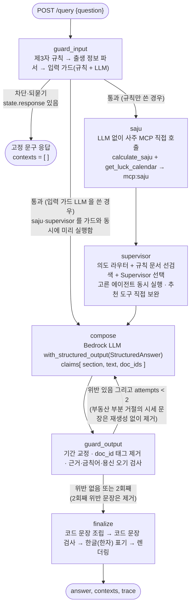
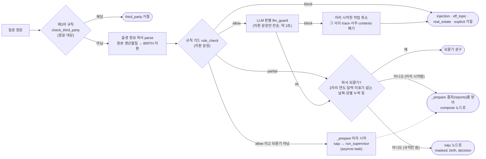
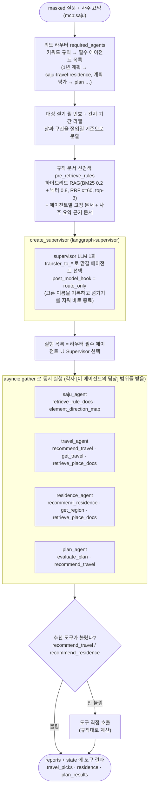
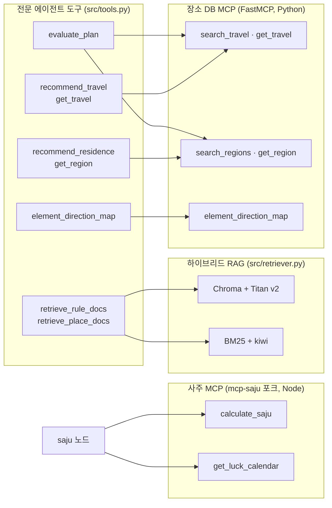
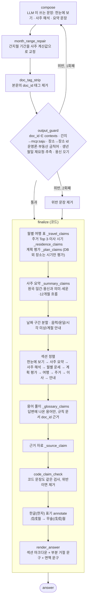
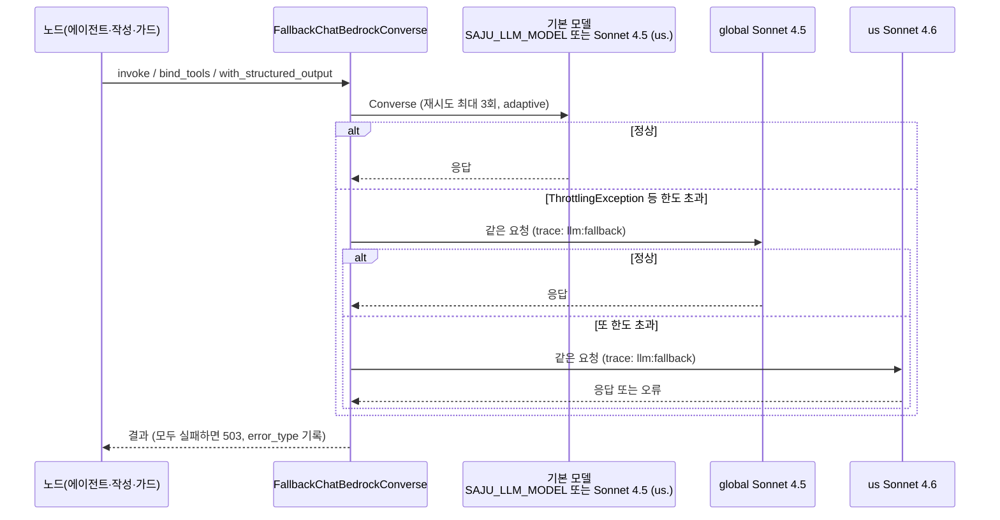
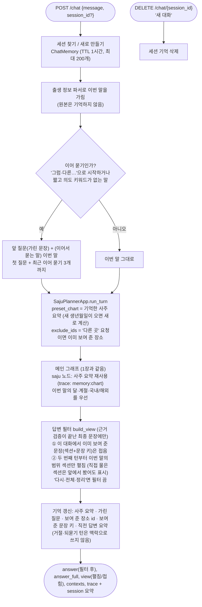
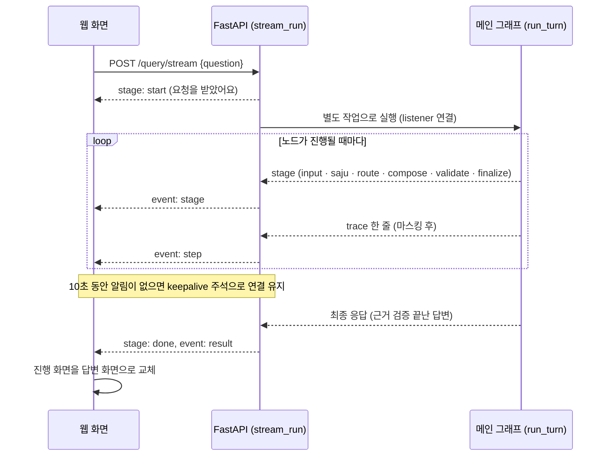

# 사주 라이프 플래너 — LangGraph 노드 구성

`POST /query` 한 번이 거치는 LangGraph 그래프와 각 노드 내부를 코드 기준으로 그린 문서다.
그래프 정의는 [src/agent.py](../src/agent.py)의 `SajuPlannerApp._build_graph`, Supervisor는 `_build_supervisor`에 있다.

> LangGraph 의 `get_graph().draw_mermaid()` 는 람다로 건 조건부 분기를 그리지 못해(`guard_input → __end__` 만 보임) 아래 그림은 코드를 읽고 직접 그렸다.

## 1. 메인 그래프 (`StateGraph(QueryState)`)

| 노드 | 함수 | LLM | 주요 trace step |
|---|---|---|---|
| `guard_input` | `guard_input` (+ 동시에 `_prepare` = `saju` → `run_supervisor`) | 입력 가드 판별 1회(치환 문장만) | `guard:input`, `parse:birth`, `llm:input_guard` |
| `saju` | `saju` → `tools.compute_chart` | 없음 | `tool:calculate_saju`, `tool:get_luck_calendar` (출력만 기록) |
| `supervisor` | `run_supervisor` | Supervisor 선택 1회 + 전문 에이전트(동시 실행) | `route`, `retrieve`, `agent:*`, `agent_tool:*`, `llm:agent` |
| `compose` | `compose` | 답변 작성 1회(+재생성 최대 1회) | `llm:compose` |
| `guard_output` | `guard_output` | 없음 | `guard:output` (`month_range_repair`, `doc_tag_strip`, `partial_refusal_drop`, `output_guard`, `drop`) |
| `finalize` | `finalize` | 없음 | `retrieve`(용어 풀이 근거), `guard:output`(`code_claim_check`) |

## 2. `guard_input` 내부 순서

- 원본 생년월일은 파서와 사주 MCP 호출 인자에만 남는다. 이후 LLM 프롬프트·trace·로그에는 `<BIRTH>`만 있다.
- 입력 가드 LLM 을 기다리는 동안 사주 계산과 전문 에이전트를 미리 돌린다. 차단되면 작업을 취소하고 그 사이의 trace·사주 요약·contexts 를 지우므로 거절 응답에는 아무것도 남지 않는다. 미리 돌린 에이전트 LLM 에는 차단될 질문도 들어가지만, 도구는 조회 전용이고 결과는 버린다.
- `partial` 이면 정상 부분은 답하고, 거절할 부분의 고정 문구는 `finalize`에서 덧붙인다.

## 3. `supervisor` 노드 내부

- langgraph-supervisor 는 넘기기를 하나씩 차례로 실행하고, 에이전트가 보고할 때마다 Supervisor LLM 을 다시 부른다(1년 계획 52초의 원인). 그래서 Supervisor 는 고르기만 하고 실행은 코드가 동시에 한다.
- 여행·주거·계획 에이전트의 보고는 400토큰·bullet 4개 이내다. 표·Top 3·등급 문장은 코드가 도구 결과로 만들기 때문이다. 사주 에이전트는 800토큰.

각 전문 에이전트는 `create_react_agent`로 만든 ReAct 루프다(LLM ↔ 도구). 도구는 아래 MCP 서버와 RAG를 부른다.

## 4. `compose` → `guard_output` → `finalize`

- 장소 선정, 이사 좋은 달·피할 달, 계획 등급, 날짜 구간 분할은 **도구 결과로 코드가 문장을 만든다.** LLM은 결론 요약과 해석만 쓴다.
- 검증은 한자 원문으로 끝낸 뒤, 사용자에게 보여 주기 직전에만 `한글(한자)`로 바꾼다.

## 5. LLM 호출과 한도 초과 대체 (`src/llm.py`)

입력 가드, Supervisor, 전문 에이전트, 답변 작성은 모두 `make_llm()`이 만드는 `FallbackChatBedrockConverse`를 쓴다.

- 한도·일시 불가 오류만 대체한다. 입력 오류(`ValidationException`)나 권한 오류는 바로 실패로 처리한다.
- 대체 순서는 `SAJU_LLM_FALLBACKS`로 바꾼다. 심사 모델(`JUDGE_MODEL`)은 라운드 비교를 위해 대체하지 않는다.

## 6. 대화 탭 (`POST /chat`, 단기 기억)

웹 화면의 '대화' 탭은 `POST /chat`을 쓴다. 채점 대상인 `POST /query`는 그대로 상태가 없다.
`/chat`은 세션(브라우저 대화)마다 짧은 기억을 서버 메모리에 두고, 같은 그래프를 `run_turn`으로 한 번 더 부른다([src/chat.py](../src/chat.py)).

| 기억하는 것 | 기억하지 않는 것 |
|---|---|
| 계산된 사주 요약(간지·용신 등 파생값), `<BIRTH>`로 가린 질문, 답변 첫 줄, 보여 준 장소 id, 보여 준 문장 키(해시), 직전 답변 요약(다시 가린 문장, 600자) | 원본 생년월일·시각·성별, 원문 메시지 |

**답변 필터** (대화 탭에서만, `/query`는 그대로):
- 중복: 코드가 만든 문장(사주 요약·용어 풀이·여행 표 등)은 같은 입력이면 같은 문장이라 섹션+문장 키로 정확히 걸러진다. '한눈에 보기'는 늘 보여 준다.
- 범위: 이번 말에 의도 키워드가 있으면 그 섹션을, 없으면(예: "그럼 해외는?") 라우터가 고른 에이전트의 섹션을 펼친다. 범위 안 내용이 모두 앞에서 본 것이면 빈 답이 되지 않게 다시 보여 준다.
- 접은 문장도 응답 `view`에 남아 화면에서 펼쳐 볼 수 있다. 직전 답변 요약을 작성 LLM 에 넘겨 같은 해석을 되풀이하지 않게 한다.
- 예(실측): 두 번째 턴 "그럼 해외는?"의 답변이 1,636자 → 326자(앞에서 본 내용 12건 접음).

## 7. 스트리밍 API (`POST /query/stream`, `POST /chat/stream`)

웹 화면은 기다리는 동안 진행 상황을 보여 주려고 스트리밍 API 를 쓴다. 기존 `/query`·`/chat` 은 그대로다.
요청 상태(`RequestState`)에 진행 리스너를 달면, 노드가 시작할 때의 단계 알림(`emit`)과 trace 한 줄(`add_step`)이 그대로 흘러간다.
리스너가 없는 기존 API 에서는 아무것도 보내지 않으므로 응답(trace 포함)이 바뀌지 않는다.

- 답변 본문은 근거 검증이 끝난 뒤 `result` 로 한 번에 보낸다. LLM 출력을 글자 단위로 흘리면 검증 전 문장(나중에 지워질 문장, 근거 누락)이 먼저 보이기 때문이다.
- 화면을 닫거나 취소하면 서버의 계산 작업도 멈춘다. 오류면 `error` 이벤트(고정 문구 + 오류 종류)를 보내고 입력은 싣지 않는다.
- 입력 가드 LLM 은 동기 호출이라 별도 스레드에서 돌려, 그동안에도 진행 알림이 막히지 않게 했다.
- 화면의 로딩: 지금 하는 일, 진행률(단계 알림 기준, 알림이 없는 동안에도 다음 단계 직전까지 천천히 차오름), 단계 체크리스트, 최근 활동, 스켈레톤, 기다리는 동안 볼 명리 상식, 예상 소요 시간, 취소.

## 8. 요청 상태와 trace

- 요청마다 `tracing.start_request()`가 `RequestState`(trace, contexts, chart, travel_picks, residence, plan_results, route, date_spans)를 새로 만든다. 상태는 요청 사이에 공유하지 않는다(멀티턴 없음).
- trace 의 input/output 은 마스킹한 뒤 300자로 자른다. 사주 MCP 호출은 출력만 남긴다.
